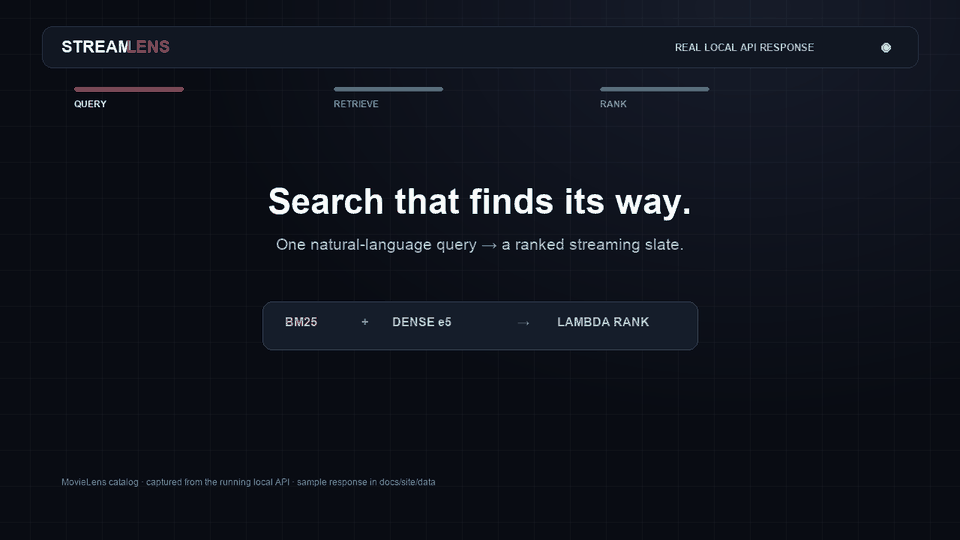

<div align="center">

# StreamLens

**Search · rank · discover**

[**Open the interactive showcase ↗**](https://akilalours.github.io/streaming-canvas-search-ltr/) · [Run locally](#run-the-app) · [Evaluation](docs/evaluation/DEFINITIVE_NUMBERS.md)

[](https://github.com/AKilalours/streaming-canvas-search-ltr/actions/workflows/ci.yml)

</div>

---

## Watch the search flow

<a href="docs/site/assets/search-flow.mp4"></a>

<sub>Click the animation for the MP4. This replay uses a response captured from the running local API; it is not a browser screen recording. <a href="docs/site/data/search-flow.json">View the exact response.</a></sub>

## Generated image outputs

<p align="center">
   &nbsp;
   &nbsp;
  
</p>

## Run the app

```bash
make setup
make serve
```

Open [Search](http://localhost:8000/demo) · [SQL explorer](http://localhost:8000/sql) · [Poster lab](http://localhost:8000/diffusion) · [API](http://localhost:8000/docs)

## Measured

**nDCG@10 0.9491** · MovieLens, 150 test queries · **p99 165.32 ms** · local `/search`, concurrency 20. [Conditions and comparison limits](docs/evaluation/DEFINITIVE_NUMBERS.md).

[Retrieval + ranking](src/retrieval) · [Personalization](src/exploration) · [Evaluation reports](reports) · [Scripts index](scripts/README.md)

<sub>The learner is a contextual bandit. Validated long-term watch outcomes and a complete online propensity-safe OPE loop are not established.</sub>
