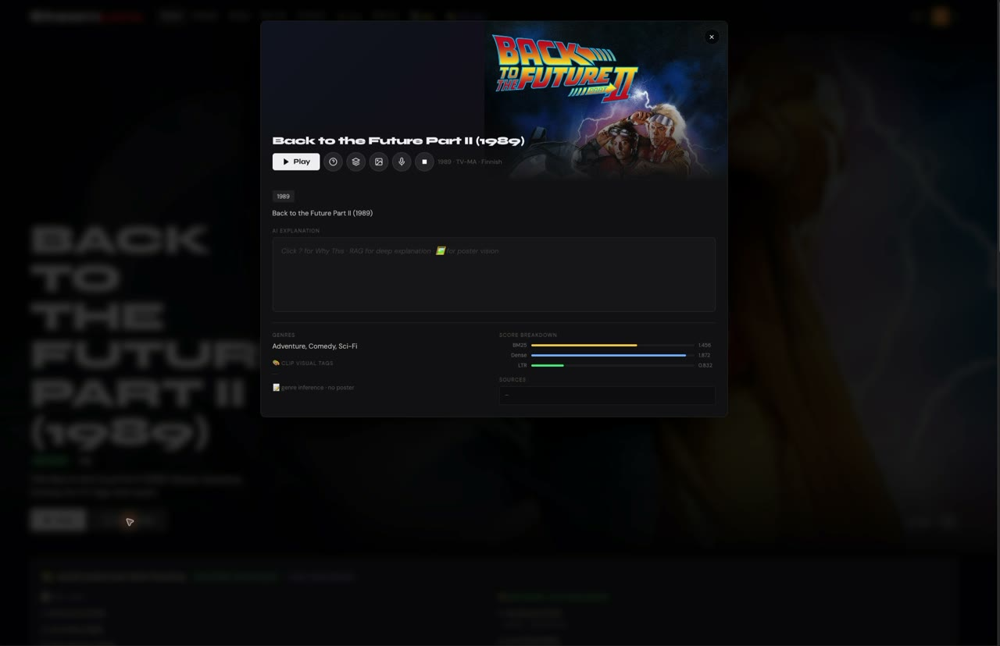
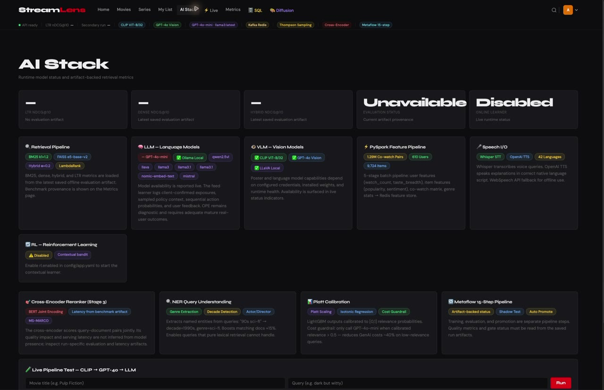
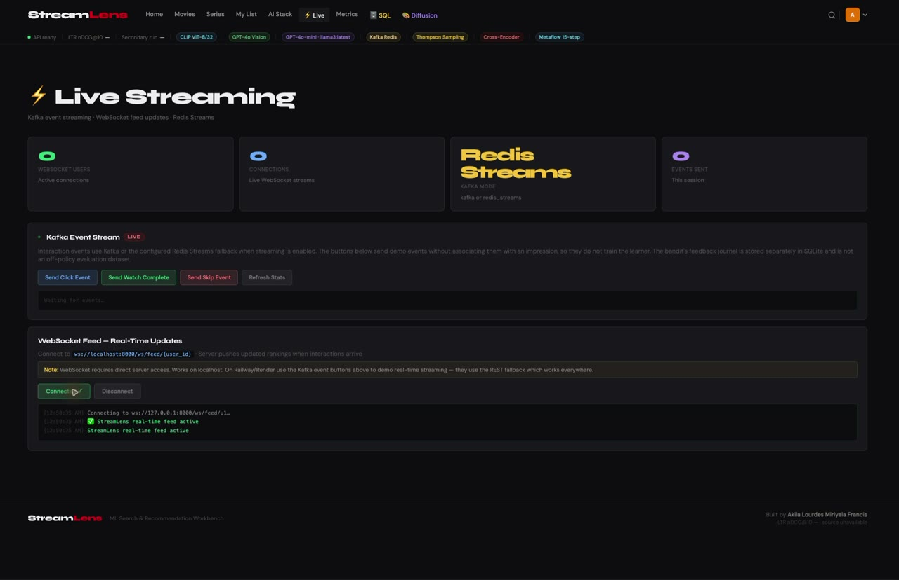
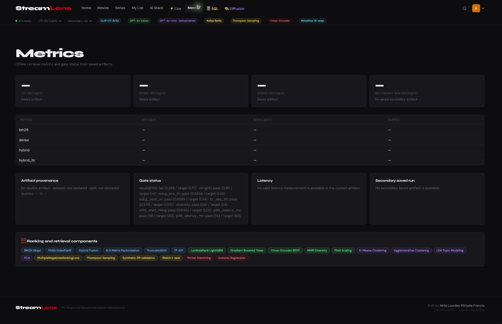
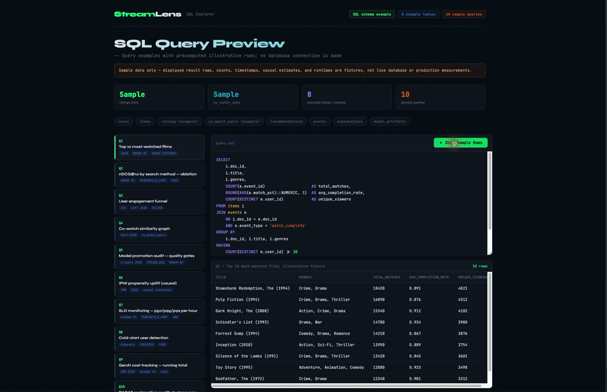
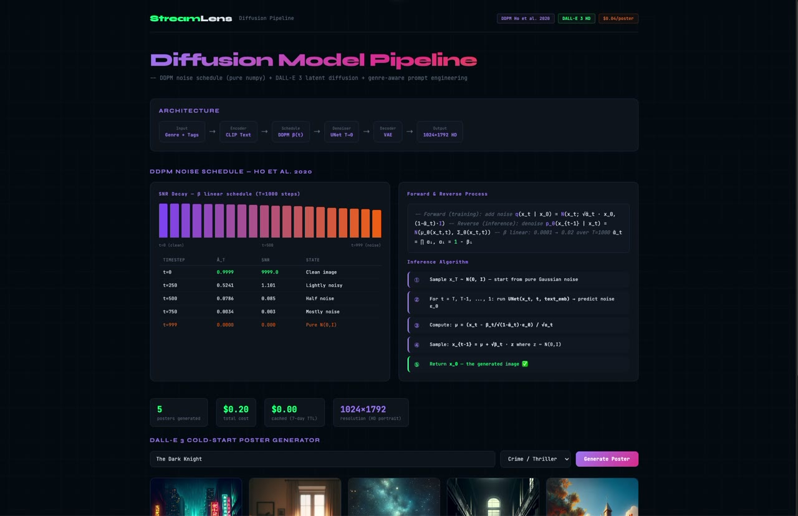
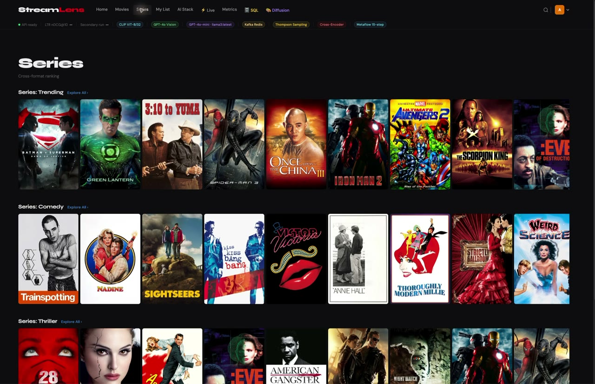
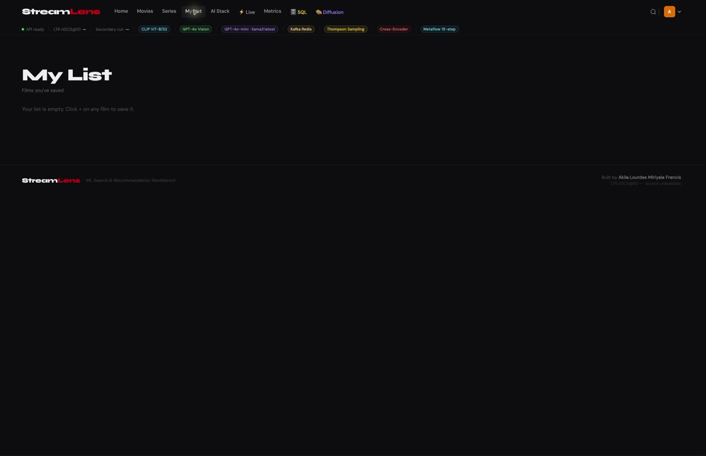

<div align="center">

# StreamLens

**Search · rank · discover**

[**Open the interactive showcase ↗**](https://akilalours.github.io/streaming-canvas-search-ltr/) · [Run locally](#run-the-app) · [Evaluation](docs/evaluation/DEFINITIVE_NUMBERS.md)

[](https://github.com/AKilalours/streaming-canvas-search-ltr/actions/workflows/ci.yml)

</div>

---

## Watch the search flow

<a href="docs/site/assets/search-flow.mp4"></a>

<sub>Click the animation for the MP4. This replay uses a response captured from the running local API; it is not a browser screen recording. <a href="docs/site/data/search-flow.json">View the exact response.</a></sub>

## The app UI

<a href="docs/site/assets/ui-tour.mp4"></a>

<sub><a href="docs/site/assets/ui-tour.mp4">Watch the 75-second app-only recording ↗</a> · Captured from the real app, cropped to its window, trimmed, and muted. The original recordings were left untouched.</sub>

<table>
  <tr>
    <td><a href="docs/site/assets/ui-profile.webp"></a><b>1 · Choose a profile</b></td>
    <td><a href="docs/site/assets/ui-home.webp"></a><b>2 · Discover titles</b></td>
  </tr>
  <tr>
    <td><a href="docs/site/assets/ui-detail.jpg"></a><b>3 · Open title details</b></td>
    <td><a href="docs/site/assets/ui-ai-stack.jpg"></a><b>4 · Inspect AI Stack</b></td>
  </tr>
  <tr>
    <td><a href="docs/site/assets/ui-live.jpg"></a><b>5 · Live controls</b></td>
    <td><a href="docs/site/assets/ui-metrics.jpg"></a><b>6 · Metrics</b></td>
  </tr>
  <tr>
    <td><a href="docs/site/assets/ui-sql.jpg"></a><b>7 · SQL Explorer</b></td>
    <td><a href="docs/site/assets/ui-diffusion.jpg"></a><b>8 · Poster lab</b></td>
  </tr>
  <tr>
    <td><a href="docs/site/assets/ui-series.jpg"></a><b>9 · Browse series</b></td>
    <td><a href="docs/site/assets/ui-my-list.jpg"></a><b>10 · My List</b></td>
  </tr>
</table>

**In the UI:** Pick a demo profile, browse or search, open title details, and explore AI Stack, Live, Metrics, SQL Explorer, Diffusion, Series, and My List. The recording shows the UI as captured; it does not imply every control was exercised. Metrics has no saved run in this capture, SQL displays explicitly labeled sample fixtures, and My List is empty.

**Languages:** The profile menu offers 42 choices for generated feed, explanation, poster-description, and text-to-speech requests. Navigation labels remain English. [Language source](src/app/main.py) · [UI selector](src/app/demo_ui/index.html).

<details>
<summary>Show all 42 language choices</summary>

Arabic · Basque · Bengali · Cantonese · Catalan · Croatian · Czech · Danish · Dutch · English · Filipino · Finnish · French (including Canadian) · Galician · German · Greek · Hebrew · Hindi · Hungarian · Icelandic · Indonesian · Italian · Japanese · Korean · Malay · Malayalam · Mandarin · Marathi · Norwegian (Bokmål) · Polish · Portuguese (including Brazilian) · Romanian · Russian · Spanish (including Latin American and Castilian) · Swahili · Swedish · Tamil · Telugu · Thai · Turkish · Ukrainian · Vietnamese

</details>

## Generated image outputs

<p align="center">
   &nbsp;
   &nbsp;
  
</p>

## Run the app

```bash
make setup
make serve
```

Open [Search](http://localhost:8000/demo) · [SQL explorer](http://localhost:8000/sql) · [Poster lab](http://localhost:8000/diffusion) · [API](http://localhost:8000/docs)

## Measured

**nDCG@10 0.9491** · MovieLens, 150 test queries · **p99 165.32 ms** · local `/search`, concurrency 20. [Conditions and comparison limits](docs/evaluation/DEFINITIVE_NUMBERS.md).

[Retrieval + ranking](src/retrieval) · [Personalization](src/exploration) · [Evaluation reports](reports) · [Scripts index](scripts/README.md)

<sub>The learner is a contextual bandit. Validated long-term watch outcomes and a complete online propensity-safe OPE loop are not established.</sub>
