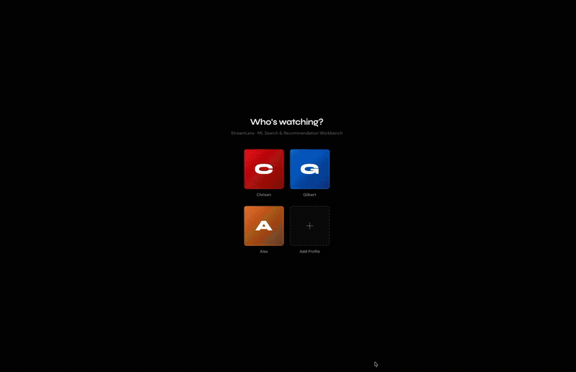
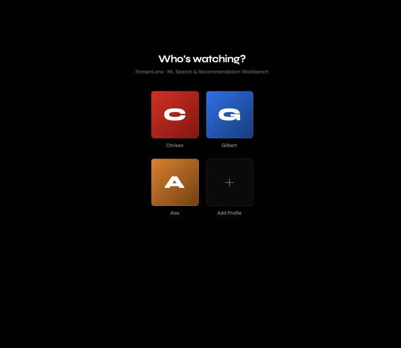
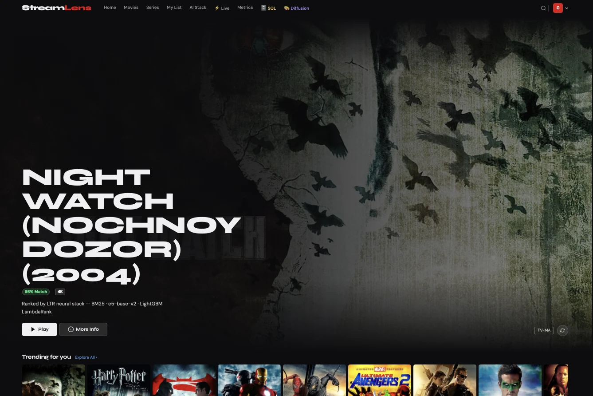

<div align="center">

# StreamLens

**Search · rank · discover**

[**Open the interactive showcase ↗**](https://akilalours.github.io/streaming-canvas-search-ltr/) · [Run locally](#run-the-app) · [Evaluation](docs/evaluation/DEFINITIVE_NUMBERS.md)

[](https://github.com/AKilalours/streaming-canvas-search-ltr/actions/workflows/ci.yml)

</div>

---

## Watch the search flow

<a href="docs/site/assets/search-flow.mp4"></a>

<sub>Click the animation for the MP4. This replay uses a response captured from the running local API; it is not a browser screen recording. <a href="docs/site/data/search-flow.json">View the exact response.</a></sub>

## The app UI

<a href="docs/site/assets/ui-tour.mp4"></a>

<sub>Click for MP4. The tour is assembled from the real UI screenshots below; it is a visual sequence, not a continuous screen recording.</sub>

<table>
  <tr>
    <td width="38%"></td>
    <td width="62%"></td>
  </tr>
  <tr>
    <td><b>1 · Pick a profile</b><br/>The selected demo profile is passed into feed requests.</td>
    <td><b>2 · Discover</b><br/>Browse recommendations, search by title or mood, and open a title for details.</td>
  </tr>
</table>

**How the UI works:** Choose a demo profile; browse Home, Movies, or Series; search for a title, genre, or mood; open a result to see details and request a “Why this?” explanation or poster description. AI Stack and Metrics show runtime and saved evaluation information. Live exposes event and WebSocket controls; SQL Explorer and Diffusion open their own pages. The My List page is present, but saving titles is not implemented yet.

**Language choices:** Open the profile menu → **Interface Language**. The current `/languages` endpoint supplies 42 choices. The selection is sent with feed, explanation, poster-description, and text-to-speech requests. It changes generated content and responses; navigation labels remain in English. The source list is in [`src/app/main.py`](src/app/main.py), and the selector is populated in [`src/app/demo_ui/index.html`](src/app/demo_ui/index.html).

<details>
<summary>Show all 42 language choices</summary>

Arabic · Basque · Bengali · Cantonese · Catalan · Croatian · Czech · Danish · Dutch · English · Filipino · Finnish · French (including Canadian) · Galician · German · Greek · Hebrew · Hindi · Hungarian · Icelandic · Indonesian · Italian · Japanese · Korean · Malay · Malayalam · Mandarin · Marathi · Norwegian (Bokmål) · Polish · Portuguese (including Brazilian) · Romanian · Russian · Spanish (including Latin American and Castilian) · Swahili · Swedish · Tamil · Telugu · Thai · Turkish · Ukrainian · Vietnamese

</details>

## Generated image outputs

<p align="center">
   &nbsp;
   &nbsp;
  
</p>

## Run the app

```bash
make setup
make serve
```

Open [Search](http://localhost:8000/demo) · [SQL explorer](http://localhost:8000/sql) · [Poster lab](http://localhost:8000/diffusion) · [API](http://localhost:8000/docs)

## Measured

**nDCG@10 0.9491** · MovieLens, 150 test queries · **p99 165.32 ms** · local `/search`, concurrency 20. [Conditions and comparison limits](docs/evaluation/DEFINITIVE_NUMBERS.md).

[Retrieval + ranking](src/retrieval) · [Personalization](src/exploration) · [Evaluation reports](reports) · [Scripts index](scripts/README.md)

<sub>The learner is a contextual bandit. Validated long-term watch outcomes and a complete online propensity-safe OPE loop are not established.</sub>
